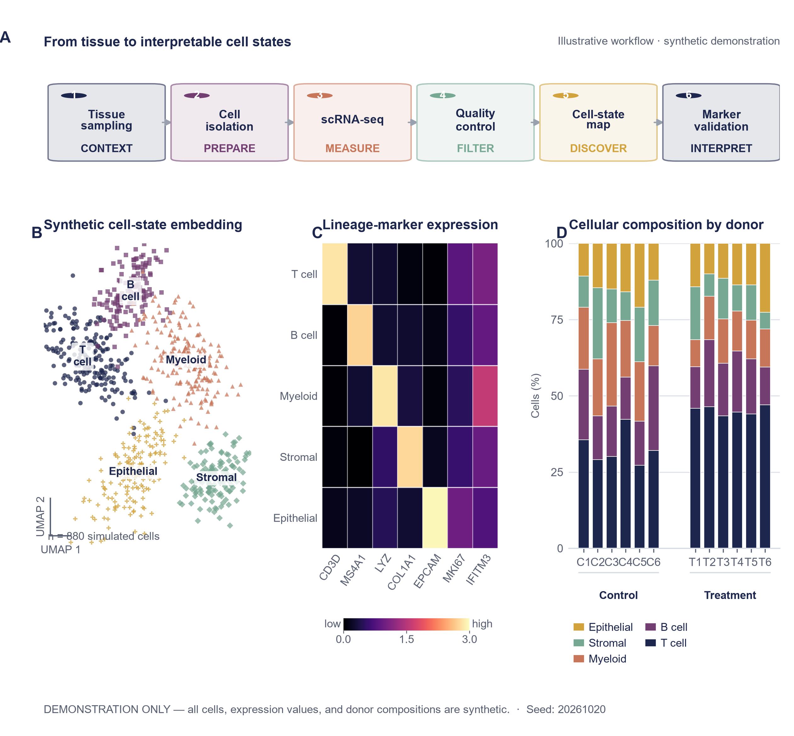

# Top Journal Figure

**From evidence to a publication-ready figure—not just a palette picker, but a
scientific figure decision system.**

`Top Journal Figure` is an evidence-first Codex skill for publication-grade plots,
multi-panel results, experimental workflows, mechanism diagrams, and graphical
abstracts. It turns a scientific claim, dataset, manuscript paragraph, or rough sketch
into an editable and reproducible figure package.

The skill was built from a structured corpus of **122 PubCNS “跟着顶刊学配色”
cases**, a license-aware review of leading open-source scientific-figure workflows,
and public chart/figure benchmarks. Those inputs were converted into an original
selection-and-rendering system that links evidence structure to figure type, layout,
semantic color, export format, and quality assurance.

## What makes it different

- **Selection before rendering.** It recommends 3–5 evidence-compatible figure types,
  explains the tradeoffs, and asks the user to choose before drawing. It is a decision
  aid, not a one-shot image generator.
- **Evidence before decoration.** Values, units, replicates, uncertainty, missingness,
  and the status of every claim are preserved in a figure contract. A beautiful figure
  that weakens the evidence fails the quality gate.
- **Corpus-grounded visual design.** Palette and composition properties are retrieved
  from a maintained 122-case top-journal style index. The system matches functional
  properties such as contrast, accent count, neutral balance, and visual weight—not
  the source artwork.
- **One system for plots and scientific diagrams.** It routes among statistical plots,
  high-dimensional views, multi-panel results, workflows, mechanisms, and graphical
  abstracts instead of treating each as an unrelated task.
- **Editable, inspectable delivery.** Data figures include deterministic Python/R
  source, SVG/PDF, PNG preview, `figure-spec.json`, `palette.json`, and `qa.json`.
- **Built to improve.** Corpus ingestion, style extraction, curated corrections,
  manifests, offline tests, and atomic updates are separated so new cases and better
  rules can be added without rewriting the skill.

## What this project is built on

This repository is an original implementation. It does not bundle or trace upstream
artwork, and it does not copy upstream code. Its design was informed by four bodies of
work:

1. **A 122-case top-journal visual corpus.** We ingested the PubCNS WeChat album
   “跟着顶刊学配色” into stable records and derived a local style index covering
   journal, palette roles, contrast, saturation, accent count, neutral balance, and
   composition cues. Only metadata and derived visual properties are distributed.
2. **Audited open-source scientific-figure workflows.** We compared seven public
   GitHub projects—including Scientific-figures-skillset, paper-banana-skill,
   Scientific-Figure-Design, sci-figure, and science-plotting-skill—to identify useful
   workflow ideas such as figure contracts, vector-first delivery, deterministic
   preflight, editable scene structures, and render–critique loops. Licenses and the
   boundary between inspiration and reuse are recorded in
   [`references/source-audit.md`](references/source-audit.md).
3. **Public figure and chart benchmarks.** ChartMimic, FigMirror, SciFigAlign, and
   SciFormaData-700K informed coverage and evaluation design for chart-to-code breadth,
   reproducibility, manuscript–figure alignment, and diagram structure. They are
   evaluation references; benchmark images are not redistributed. See
   [`references/benchmarking.md`](references/benchmarking.md).
4. **An evidence-first engineering layer developed for this skill.** We implemented
   the figure-type selection gate, evidence contracts, semantic palette roles,
   final-size layout rules, accessibility checks, deterministic exports, structured QA,
   provenance boundaries, and a maintainable corpus-update pipeline.

The result is not a promise to imitate a journal's visual surface. It is a reusable
workflow for applying the underlying principles—evidence hierarchy, visual economy,
semantic consistency, accessibility, editability, and reproducibility—to new research.

## Quick start

Place this repository at:

```text
<CODEX_HOME>/skills/top-journal-figure
```

When `CODEX_HOME` is not configured, the usual Windows location is:

```text
%USERPROFILE%/.codex/skills/top-journal-figure
```

Then invoke it in Codex:

```text
使用 $top-journal-figure，根据我的数据制作论文插图。
```

The skill first responds with a compact selection such as:

```text
1. Box plot + raw points — Recommended; preserves the observations.
2. Raincloud plot — reveals distribution shape but needs more width.
3. Violin + points — compact, but smoothing can mislead at small n.
4. Let the skill choose automatically.
```

It renders only after the figure type is confirmed, unless the request explicitly says
to skip selection and proceed automatically.

## Supported work

The routing system covers group comparisons, distributions, trends, relationships,
composition, high-dimensional data, statistics/model diagnostics, networks, spatial
evidence, workflows, architectures, mechanisms, and graphical abstracts. Common forms
include box/violin/raincloud plots, survival curves, scatter and regression plots,
heatmaps, volcano plots, PCA/UMAP, forest plots, Sankey diagrams, experimental workflows,
pathway schematics, and multi-panel manuscript figures.

## Repository layout

```text
top-journal-figure/
├─ SKILL.md                    # Skill entry point and workflow
├─ agents/openai.yaml          # Codex display metadata
├─ assets/                     # Corpus, archetypes, and curated overrides
├─ references/                 # Selection, design, provenance, and maintenance rules
├─ scripts/                    # Corpus update, recommendation, and validation tools
├─ tests/                      # Offline smoke tests
└─ examples/                   # Reproducible demonstration figure
```

## Corpus updates

Install the updater dependencies:

```powershell
python -m pip install -r requirements.txt
```

Preview a refresh without changing the tracked corpus:

```powershell
python scripts/update_corpus.py --check
```

Apply an update only after reviewing the added, changed, and removed stable IDs:

```powershell
python scripts/update_corpus.py
```

Generated corpus files must never be edited by hand. Corrections belong in
`assets/curated/overrides.json`. See
[`references/maintenance.md`](references/maintenance.md) for the versioning contract.

## Development and validation

```powershell
python -m pip install -r requirements-dev.txt
python tests/smoke_test.py
python scripts/validate_release.py
python scripts/validate_figure_spec.py assets/example-figure-spec.json
```

The included GitHub Actions workflow runs the offline checks on pull requests and pushes.
Network-dependent corpus refreshes are deliberately excluded from CI.

## Example

The repository includes a deterministic synthetic single-cell example combining a
workflow, embedding, marker heatmap, and donor-level composition. Every value is labelled
as synthetic and the editable source accompanies the render.



## Data and licensing

Original code and documentation in this repository are licensed under Apache-2.0.
Third-party article titles, URLs, journal names, trademarks, and source visual works remain
the property of their respective owners. No source artwork is bundled. Read
[`DATA_AND_THIRD_PARTY_NOTICE.md`](DATA_AND_THIRD_PARTY_NOTICE.md) before redistributing a
corpus build.

## 中文简介

这不是一个简单的“顶刊配色库”，而是一套从证据到成图的科研插图决策系统。它会先
检查数据、论点与证据结构，再给出 3–5 个适合的图型及取舍，让用户确认后才开始绘制；
随后统一处理布局、语义配色、可编辑输出和最终尺寸质检。

本项目建立在四类工作之上：对 PubCNS 122 篇“跟着顶刊学配色”案例的结构化整理与
视觉特征提取；对 7 个 GitHub 开源科研绘图项目的许可与工作流审计；对 ChartMimic、
FigMirror、SciFigAlign 和 SciFormaData-700K 等公共资源的评测方法借鉴；以及我们自行
实现的图型选择门、证据契约、可重复渲染、质量检查和可持续更新管线。输出包含
Python/R 源码、可编辑 SVG/PDF、PNG 预览、图形规格、配色映射与 QA 记录。项目不包含、
临摹或重新分发原始文章图片。
